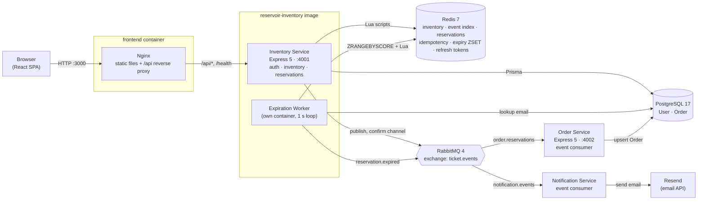
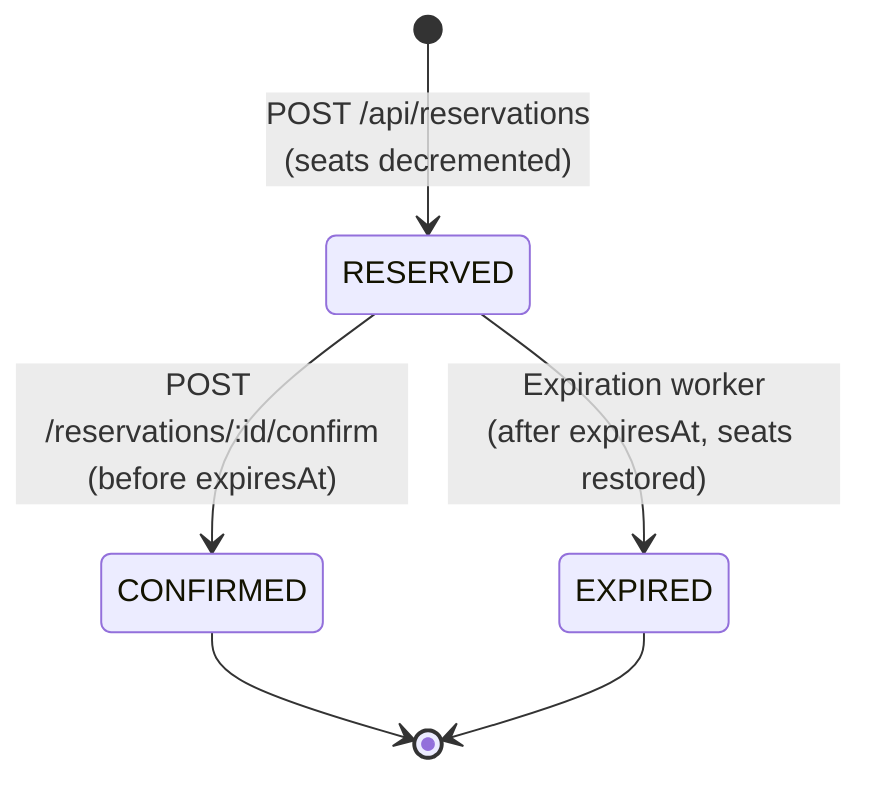
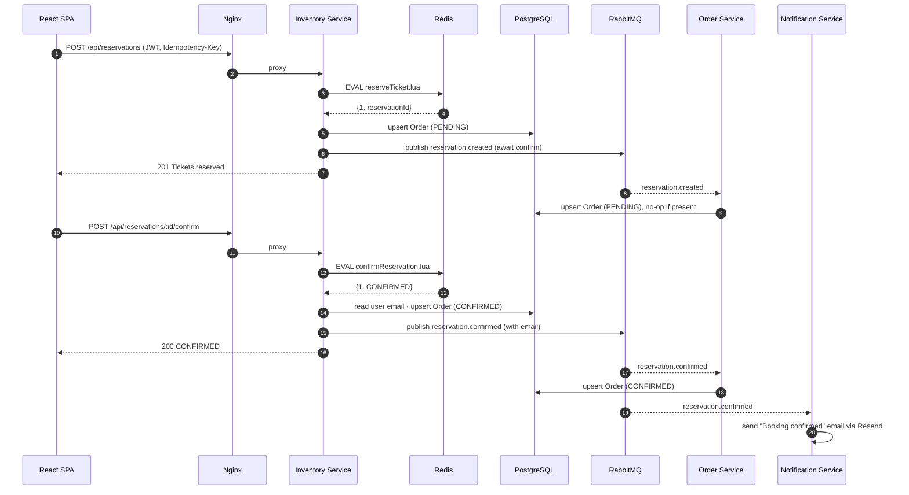
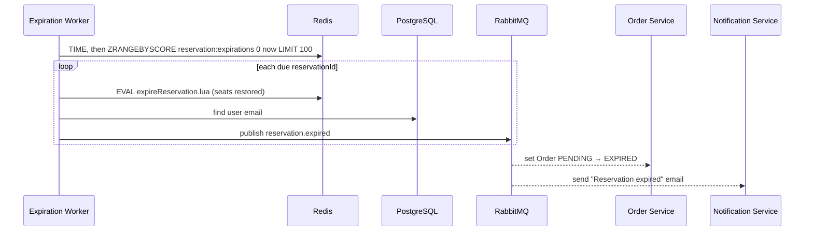
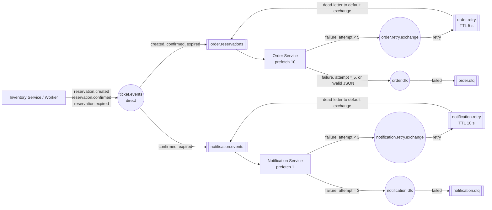
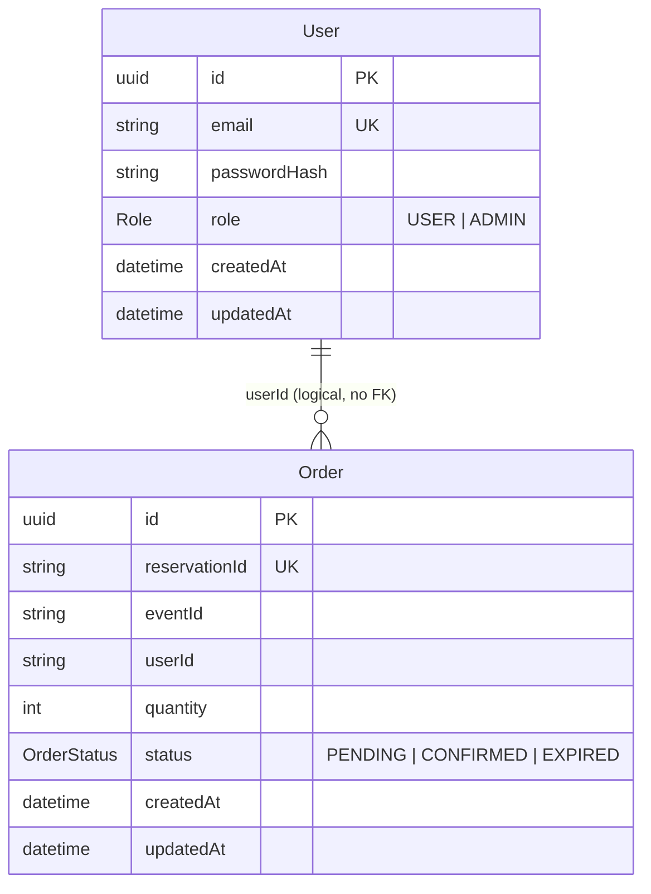

# Architecture

This document describes how the Reservoir ticket-booking system is built: the services, how they talk to each other, where data lives, and the guarantees each piece provides.

For setup and usage, see the [README](README.md).

---

## 1. System overview

Reservoir is an **event-driven microservice system**. A React SPA talks to a single HTTP API (the Inventory Service). That service owns the hot path (seat counts and reservations) in **Redis**, persists users and orders in **PostgreSQL**, and publishes domain events to **RabbitMQ**. Downstream services (Order, Notification) react to those events asynchronously.



### Components at a glance

| Component | Path | Tech | Responsibility |
|---|---|---|---|
| Frontend | [ticket-booking-frontend/](ticket-booking-frontend/) | React 19, React Router 7, Vite 8, Nginx 1.27 | Event catalogue, booking modal, "My Bookings", admin inventory editor, auth UI |
| Inventory Service | [services/inventory_service/](services/inventory_service/) | Node 22, Express 5, node-redis 6, Prisma 7, amqplib, JWT, bcrypt | Public HTTP API. Auth, inventory management, reservations, confirmation, order listing |
| Expiration Worker | [services/inventory_service/src/workers/](services/inventory_service/src/workers/reservationExpirationWorker.js) | Node 22 | Releases seats from reservations that were not confirmed before their TTL. Runs as the `expiration-worker` Compose service |
| Order Service | [services/order_service/](services/order_service/) | Node 22, Express 5, Prisma 7, amqplib | Projects reservation events into the `Order` table |
| Notification Service | [services/notification_service/](services/notification_service/) | Node 22, amqplib, Resend | Sends confirmation and expiry emails, with retry and dead-lettering |
| Redis | `docker-compose.yml` | Redis 7 (AOF/RDB volume) | Source of truth for **available seats** and **reservation state** |
| PostgreSQL | `docker-compose.yml` | Postgres 17 | Durable store for **users** and **orders** |
| RabbitMQ | `docker-compose.yml` | RabbitMQ 4 + management UI | Durable event bus between services |

---

## 2. Architectural style and key decisions

| Decision | Why |
|---|---|
| **Redis as the inventory store** | Seat counts change on every booking and are read on every page load. Redis keeps them in memory, and single-threaded Lua execution makes check-and-decrement atomic without row locks. |
| **Lua scripts for every state change** | `reserveTicket.lua`, `confirmReservation.lua` and `expireReservation.lua` each run as one atomic unit. Two users can never both take the last seat, and a seat is never released twice. |
| **Redis server time (`TIME`)** | Reservation expiry uses the Redis clock rather than each app server's clock, so clock drift between containers does not matter. |
| **Idempotency keys on reservations** | Clients send an `Idempotency-Key` header. A retried request (network blip, double click) returns the original reservation instead of taking more seats. |
| **Event-driven side effects** | Writing orders and sending emails happen in other services through RabbitMQ. A slow email provider can't block or fail a booking. |
| **Publisher confirms + durable queues + persistent messages** | The Inventory Service waits for the broker's acknowledgement before replying, and messages survive a broker restart. |
| **Idempotent consumers (upserts keyed on `reservationId`)** | RabbitMQ delivers *at least once*. Upserts and conditional updates make re-delivery harmless. |
| **Retry queue + DLQ for notifications** | Temporary email failures are retried after a delay. Messages that keep failing are kept in a DLQ for inspection rather than lost or retried forever. |
| **Same-origin API via Nginx** | The browser calls relative `/api/...` URLs. Nginx (prod) or the Vite proxy (dev) forwards them, so CORS and Docker hostnames never reach browser code. |

---

## 3. Inventory Service (core API)

### 3.1 Internal layering

```
src/
├── server.js          Bootstraps Redis → RabbitMQ → HTTP; graceful SIGTERM/SIGINT shutdown
├── app.js             Express app: CORS, JSON, /health, routes, 404, error handler
├── routes/            URL → middleware → controller wiring
├── middleware/
│   ├── authMiddleware.js   Verifies HS256 JWT (issuer/audience pinned) → req.user
│   └── requireRole.js      RBAC guard (USER / ADMIN)
├── controllers/       Input validation, HTTP status mapping, ownership checks
├── services/          Business logic
│   ├── authService.js                 bcrypt (cost 12), JWT (15 min), rotating refresh tokens (7 days)
│   ├── inventoryService.js            Redis reads/writes + Lua invocation
│   ├── reservationPublisher.js        Publishes reservation.created
│   ├── reservationEventPublisher.js   Publishes created / confirmed / expired
│   └── reservationExpirationService.js Batch expiry used by the worker
├── scripts/           Atomic Redis Lua scripts
├── workers/           Long-running background processes
└── config/            Redis, Prisma (pg adapter) and RabbitMQ clients
```

Requests flow **route → middleware → controller → service → infrastructure client**. Controllers never touch Redis directly except for read-only enrichment in `getUserOrders`.

### 3.2 HTTP API

All routes are served on port `4001` and reachable through Nginx at `http://localhost:3000`.

| Method | Path | Auth | Description |
|---|---|---|---|
| `GET` | `/health` | — | Liveness probe |
| `POST` | `/api/auth/register` | — | Create user (`email`, `password` 8–72 chars). Role defaults to `USER` |
| `POST` | `/api/auth/login` | — | Returns `{ user, token, refreshToken, refreshExpiresIn }`. The JWT is valid for 15 minutes, the refresh token for 7 days |
| `POST` | `/api/auth/refresh` | Refresh token in body | Swaps `{ refreshToken }` for a new token pair. The old refresh token stops working. `401` if invalid, expired or already used |
| `POST` | `/api/auth/logout` | Refresh token in body | Revokes `{ refreshToken }`. Always returns `204` |
| `GET` | `/api/auth/me` | Bearer | Current user profile |
| `GET` | `/api/events` | — | All events with `available > 0`, merged with their metadata |
| `GET` | `/api/events/:eventId/inventory` | — | `{ eventId, available }` |
| `PUT` | `/api/admin/events/:eventId/inventory` | Bearer + `ADMIN` | Set seat count and metadata (`quantity`, `name`, `category`, `icon`, `date`, `location`, `price`, `type`) |
| `DELETE` | `/api/admin/events/:eventId/inventory` | Bearer + `ADMIN` | Remove an event's inventory and metadata |
| `POST` | `/api/reservations` | Bearer + `Idempotency-Key` | Reserve `quantity` (1–10) seats for `eventId` |
| `GET` | `/api/reservations/:id` | Bearer (owner or admin) | Reservation details |
| `POST` | `/api/reservations/:id/confirm` | Bearer (owner or admin) | Confirm a live reservation |
| `GET` | `/api/orders` | Bearer | The caller's orders, enriched with event metadata |

**Validation rules:** IDs must match `^[a-zA-Z0-9_-]{1,64}$`. Idempotency keys must match `^[a-zA-Z0-9_-]{8,128}$`. User identity always comes from the verified JWT (`sub`), never from the request body.

**Error mapping:**

| Condition | Status |
|---|---|
| Bad input | `400` |
| Missing, invalid or expired token | `401` |
| Wrong role or not the owner | `403` |
| Unknown event or reservation | `404` |
| Duplicate email, not enough seats, reservation expired or inactive | `409` |
| Anything else | `500` (details only in server logs) |

### 3.3 Redis data model

| Key | Type | Contents | Lifetime |
|---|---|---|---|
| `inventory:{eventId}` | String (integer) | Seats currently available | Until admin deletes |
| `event:meta:{eventId}` | String (JSON) | `name, category, icon, date, location, price, type` | Until admin deletes |
| `reservation:{reservationId}` | String (JSON) | `reservationId, eventId, userId, quantity, status, expiresAt, confirmedAt?, expiredAt?` | No TTL (kept as history) |
| `idempotency:{userId}:{key}` | String | `reservationId` | `RESERVATION_TTL_SECONDS` |
| `reservation:expirations` | Sorted set | member = `reservationId`, score = `expiresAt` (Unix s) | Entry removed on confirm/expire |
| `events:index` | Set | Every `eventId` that has inventory. `GET /api/events` reads it instead of running `KEYS` | Updated atomically (`MULTI`) on admin create/delete. Filled with `SCAN` on startup for older data |
| `refresh:{sha256(token)}` | String (JSON) | `{ userId, issuedAt }`. Only the hash is stored, never the token itself | `REFRESH_TOKEN_TTL_SECONDS` (7 days). Deleted when the token is used or on logout |

Idempotency keys are scoped **per user**, so two users can't collide even if they send the same key.

### 3.4 Atomic Lua scripts

| Script | Keys touched | What it does atomically |
|---|---|---|
| [reserveTicket.lua](services/inventory_service/src/scripts/reserveTicket.lua) | inventory, reservation, idempotency, expirations | Returns the existing reservation for a replayed idempotency key. Otherwise checks `available ≥ quantity`, `DECRBY`, writes the reservation (`RESERVED`, `expiresAt = TIME + ttl`), stores the idempotency key with TTL, and adds it to the expiry ZSET |
| [confirmReservation.lua](services/inventory_service/src/scripts/confirmReservation.lua) | reservation, expirations | Accepts only `RESERVED` and not yet expired. Sets `CONFIRMED`, removes it from the expiry ZSET. Re-confirming returns `ALREADY_CONFIRMED` (idempotent) |
| [expireReservation.lua](services/inventory_service/src/scripts/expireReservation.lua) | reservation, inventory, expirations | Accepts only `RESERVED` and actually past `expiresAt` (checked against Redis `TIME`). `INCRBY` returns the seats, then sets `EXPIRED` |

### 3.5 Reservation lifecycle



The `Order` row in PostgreSQL mirrors this as `PENDING → CONFIRMED | EXPIRED`.

---

## 4. End-to-end booking flow

The frontend reserves and then confirms in one click ("Confirm & Pay"). Pending reservations can also be confirmed later from **My Bookings**.



### Expiry flow



The worker runs every 1 s with a re-entrancy guard and finishes its current batch before shutting down. Because the Lua script re-checks state, running several workers at once is safe: each reservation is expired exactly once.

---

## 5. Messaging topology (RabbitMQ)



**Message format** (JSON, `persistent: true`, `messageId = reservationId`):

```json
{
  "eventType": "reservation.confirmed",
  "reservationId": "3f0c…",
  "eventId": "concert101",
  "userId": "a1b2…",
  "email": "user@example.com",
  "quantity": 2,
  "status": "CONFIRMED",
  "occurredAt": "2026-11-07T10:00:00.000Z"
}
```

`email` is only included on `confirmed` and `expired` events.

**Delivery guarantees:**

- **Producer:** confirm channel. HTTP handlers wait for the broker ack before responding.
- **Order consumer:** manual ack after the DB write. Handlers are idempotent upserts. On error the message is republished to `order.retry` and comes back after 5 s, up to 5 attempts (counted in `x-retry-count`). After that it goes to `order.dlq` with `x-failure-reason`. Invalid JSON goes straight to the DLQ. As with notifications, the original is acked only after the hand-off is confirmed, and is requeued if the hand-off fails. The main queue's settings are unchanged because the Inventory Service declares the same queue.
  - *Ordering:* a retried message can arrive after a later event for the same reservation. Upserts cover every case except `expired` arriving before `created`, which leaves the order `PENDING`. `GET /api/orders` corrects it on the next read by checking Redis (see §6).
- **Notification consumer:** the retry count is kept in the `x-retry-count` header, with up to 3 attempts 10 s apart, after which the message goes to `notification.dlq` with `x-failure-reason`. The original is acked only after the retry/DLQ publish is confirmed, so nothing is lost during the handoff.

---

## 6. PostgreSQL data model

Managed by Prisma 7 with the `@prisma/adapter-pg` driver adapter. Migrations live in [services/inventory_service/prisma/migrations/](services/inventory_service/prisma/migrations/). The Order Service keeps an identical copy of the schema so it can generate its own client.



The unique index on `Order.reservationId` is what makes every order write idempotent across both writers (the Inventory Service and the Order Service).

**Consistency approach:** the Inventory Service writes the `Order` row *synchronously* so that "My Bookings" is correct immediately. The Order Service applies the same change *asynchronously* from events, as a backstop. `GET /api/orders` also **self-heals**: if an order is still `PENDING` in Postgres but Redis says `CONFIRMED` or expired, it corrects the row as it reads it.

---

## 7. Frontend

```
src/
├── main.jsx                 React root
├── App.jsx                  Router, nav, booking modal, booking state & orchestration
├── pages/
│   ├── Events.jsx           Live event grid (from GET /api/events)
│   └── Bookings.jsx         User's orders, confirm-pending action, refresh
├── components/
│   ├── EventCard.jsx
│   ├── AuthModal.jsx        Login / register tabs
│   └── AdminAddTicketsModal.jsx  Create / update / delete event inventory (ADMIN only)
├── context/                 AuthContext + AuthProvider + useAuth hook
├── services/api.js          All fetch calls to the backend
└── config/api.js            API_BASE_URL (VITE_API_URL, default same-origin)
```

- **Auth state:** the JWT, refresh token and user are kept in `localStorage`.
  - `AuthProvider` refreshes the session about 60 s before the access token expires, or straight away if it already has. Simultaneous refresh attempts share one request.
  - If `/api/auth/me` fails, it tries a refresh first and only logs the user out if that also fails.
  - A `storage` event listener keeps open tabs in sync on login, refresh and logout. A tab that loses a refresh race to another tab picks up that tab's new token instead of logging out.
  - Logout revokes the refresh token on the server.
- **Bookings:** server orders are merged with a per-user `localStorage` cache (`ticket_bookings_{userId}`). A local `CONFIRMED` status is never downgraded to `PENDING` by a stale server read.
- **Cache busting:** event and order requests add `?_t=` and `Cache-Control: no-cache`. The server also sends `no-store`.
- **Styling:** plain CSS with one stylesheet per component. A light theme is defined by design tokens (colours, radii, shadows, motion timings) in `src/index.css`, which also holds the shared keyframes. The motion includes:
  - page fade on route change (`.page-transition`, keyed by path)
  - staggered card entrances (a `--i` CSS variable per card)
  - skeleton loading cards
  - modal rise-in and toast slide-in with a countdown bar
  - micro-interactions on buttons and on the quantity stepper

  All of it is disabled under `prefers-reduced-motion`.
- **Serving:** a multi-stage Docker build (Node → Nginx). Nginx serves the SPA with `try_files` fallback, gzip, 1-year immutable caching for hashed assets, `/nginx-health`, and proxies `/api/` and `/health` to `inventory:4001` using Docker's DNS resolver (`127.0.0.11`).

---

## 8. Security model

| Concern | Implementation |
|---|---|
| Password storage | bcrypt, cost factor 12. Length 8–72 (bcrypt's input limit) |
| Tokens | HS256 JWT, 15 min expiry, `issuer=reservoir-api`, `audience=reservoir-client`, algorithm pinned on verify |
| Refresh tokens | 48 random bytes (base64url), stored only as a SHA-256 hash with a 7-day TTL. Single-use: `GETDEL` makes rotation atomic. The user's role is re-read on every refresh, so a role change takes effect within 15 minutes. Revoked on logout. They live in `localStorage`, the same as the access token, so they are readable by any XSS; an `httpOnly` cookie would be stronger |
| Authorization | `requireRole("ADMIN")` for inventory writes. Owner-or-admin checks for reading or confirming reservations |
| User enumeration | Login returns the same error for an unknown email and a wrong password |
| Input validation | Strict regex for IDs and keys, integer bounds on quantities |
| Error leakage | The centralised handler returns a generic 500. Details are logged only on the server |
| Secrets | `.env` files are git- and docker-ignored. Only `.env.example` files are committed. Infrastructure credentials come from the root `.env` |

There is no self-service admin signup. You promote a user to admin directly in the database (see the README).

---

## 9. Deployment topology

`docker-compose.yml` runs eight containers on one bridge network with named volumes `redis_data`, `postgres_data` and `rabbitmq_data`. Postgres and RabbitMQ credentials come from a root `.env` file (template: `.env.example`) and fall back to local-development defaults.

| Service | Host port → container | Health check | Waits for |
|---|---|---|---|
| frontend | `3000 → 80` | `wget /nginx-health` (Dockerfile) | inventory |
| inventory | `4001 → 4001` | — | redis, postgres, rabbitmq (healthy) |
| expiration-worker | — (same `reservoir-inventory` image) | — | inventory (started), redis, postgres, rabbitmq (healthy) |
| order | not published (4002 internal) | — | postgres, rabbitmq (healthy) |
| notification | — | — | rabbitmq (healthy) |
| redis | `6379 → 6379` | `redis-cli ping` | — |
| postgres | `15433 → 5432` | `pg_isready` | — |
| rabbitmq | `5673 → 5672`, `15673 → 15672` (UI) | `rabbitmq-diagnostics ping` | — |

All services use `restart: unless-stopped`. The Node services connect to their dependencies before they start listening, and they close connections cleanly on `SIGTERM`, so `docker compose up -d --build <service>` replaces a container without dropping messages.

**CI:** [.github/workflows/deploy.yaml](.github/workflows/deploy.yaml) runs on pushes to `main`:

1. **`test`:** starts a Redis service container and runs the inventory test suite.
2. **`build-and-push`:** runs only if the tests pass. A matrix job builds `reservoir-frontend`, `reservoir-inventory`, `reservoir-order` and `reservoir-notification`, and pushes each to GHCR tagged `latest` and with the commit SHA. The expiration worker uses the `reservoir-inventory` image.

---

## 10. Scalability characteristics

| Component | Scales horizontally? | Notes |
|---|---|---|
| Inventory Service | ✅ Stateless | All shared state is in Redis and Postgres. Lua keeps correctness under concurrency |
| Expiration Worker | ✅ | Lua re-checks state, so concurrent workers are safe (the extra ones do redundant work) |
| Order Service | ✅ | Competing consumers on `order.reservations`. Writes are idempotent |
| Notification Service | ✅ | Competing consumers. `prefetch(1)` keeps work evenly spread |
| Redis | ⚠️ Single node | Lua scripts touch several keys. Redis Cluster would need hash tags so related keys share a slot |
| `GET /api/events` | ✅ | Reads the `events:index` set, then two `MGET`s, so two round trips whatever the catalogue size. No keyspace scan |
